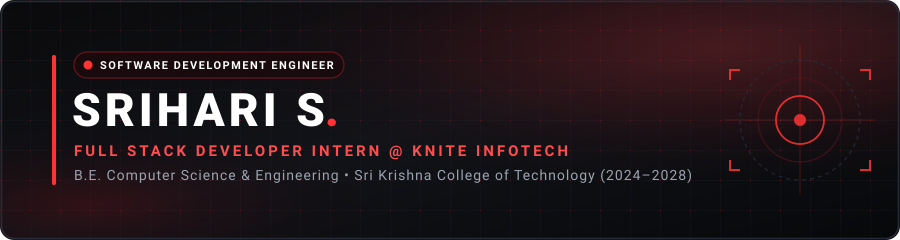
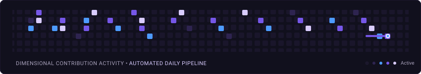

<div align="center">

<!-- Hero Banner -->
<a href="https://github.com/Srihari-Asus">
  
</a>

<br/>

<!-- Animated Typing Introduction -->
<a href="https://github.com/Srihari-Asus">
  
</a>

<br/>

<!-- Social & Profile Links -->
<p align="center">
  <a href="https://www.linkedin.com/in/sriharis2305" target="_blank">
    
  </a>
  <a href="https://leetcode.com/u/Srihari_Leetcode/" target="_blank">
    
  </a>
  <a href="https://github.com/Srihari-Asus" target="_blank">
    
  </a>
</p>

<!-- Quick Status Badges -->
<p align="center">
  
  
  
</p>


</div>

## 📌 About Me

```yaml
Name: Srihari S
Role: Software Development Engineer Aspirant
Current_focus: Full Stack Engineering, DSA & Scalable Systems
Internship: Full Stack Developer Intern @ Knite Infotech
Education:
  Degree: B.E. Computer Science and Engineering
  Institution: Sri Krishna College of Technology
  Timeline: 2024 — 2028
```

- 🎯 **Career Target:** Software Development Engineer (SDE)
- 💼 **Professional Experience:** Completed intern as a **Full Stack Developer Intern** at **Knite Infotech**, developing responsive frontend interfaces and reliable backend services.
- 🎓 **Academic Foundation:** Pursuing Computer Science and Engineering at **Sri Krishna College of Technology**, focusing on data structures, algorithmic efficiency, and software architecture.

<div align="center">
  
</div>

## 💻 Technical Arsenal

<div align="center">

| Domain | Technologies |
| :--- | :--- |
| **Programming Languages** |  |
| **Frontend Development** |  |
| **Backend Engineering** |  |
| **Databases & Cloud** |  |
| **Development Tools** |  |

</div>

<div align="center">
  
</div>

## 🚀 Featured Projects

<table width="100%">
  <tr>
    <td width="50%" valign="top">
      <h3 align="center">🌱 AgroPlay</h3>
      <p align="center">
        
        
      </p>
      <p>An AI-assisted smart farming ecosystem designed to deliver actionable digital intelligence, optimize agricultural workflows, and enhance sustainable farming practices.</p>
      <ul>
        <li><b>Focus:</b> AI Integration, Sustainable Tech, Smart Agriculture</li>
        <li><b>Ecosystem:</b> Full Stack Architecture with Intelligent Decision Support</li>
      </ul>
    </td>
    <td width="50%" valign="top">
      <h3 align="center">📝 Quiz Management Application</h3>
      <p align="center">
        
        
      </p>
      <p>A comprehensive assessment and examination management system built with enterprise backend standards, automated grading logic, and secure relational data persistence.</p>
      <ul>
        <li><b>Technologies:</b> Java, Spring Boot, Spring Data JPA, MySQL</li>
        <li><b>Highlights:</b> RESTful Services, Relational Schema Design, JPA ORM</li>
      </ul>
    </td>
  </tr>
</table>

<div align="center">
  
</div>

## 🧩 Problem Solving & Competitive Programming

<div align="center">

<a href="https://leetcode.com/u/Srihari_Leetcode/" target="_blank">
  
</a>

<br/>

<a href="https://leetcode.com/u/Srihari_Leetcode/" target="_blank">
  
</a>

</div>

<div align="center">
  
</div>

## 🏆 Honors & Achievements

- 🥇 **DHRUVA '26** — **First Place** among 70+ participating teams.
- 🏅 **Smart India Hackathon** — Recognized in the **Top 500** nationally.

<div align="center">
  
</div>

## 📊 GitHub Analytics

<div align="center">

  <table border="0">
    <tr>
      <td align="center">
        <a href="https://github.com/Srihari-Asus">
          
        </a>
      </td>
      <td align="center">
        <a href="https://github.com/Srihari-Asus">
          
        </a>
      </td>
    </tr>
  </table>

  <br/>

  <a href="https://github.com/Srihari-Asus">
    
  </a>

</div>

<div align="center">
  
</div>

## 🐍 Contribution Graph

<div align="center">

<picture>
  <source media="(prefers-color-scheme: dark)" srcset="https://raw.githubusercontent.com/Srihari-Asus/Srihari-Asus/output/github-contribution-grid-snake-dark.svg" />
  <source media="(prefers-color-scheme: light)" srcset="https://raw.githubusercontent.com/Srihari-Asus/Srihari-Asus/output/github-contribution-grid-snake.svg" />
  
</picture>

</div>

<div align="center">
  
</div>

## 🤝 Connect With Me

<div align="center">

<a href="https://www.linkedin.com/in/sriharis2305" target="_blank">
  
</a>
&nbsp;&nbsp;
<a href="https://leetcode.com/u/Srihari_Leetcode/" target="_blank">
  
</a>
&nbsp;&nbsp;
<a href="https://github.com/Srihari-Asus" target="_blank">
  
</a>

<br/><br/>

<sub>Designed with precision • <b>Srihari S</b> • 2026</sub>

</div>
