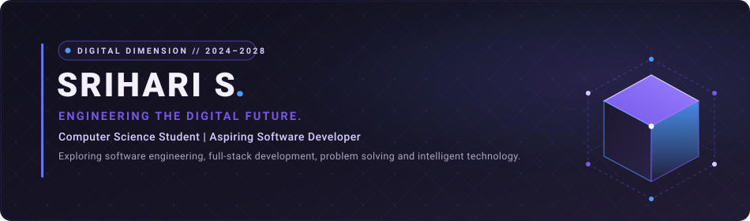

<div align="center">

<!-- Dimensional Futuristic Hero Header -->
<a href="https://github.com/Srihari-Asus">
  
</a>

<br/>

<!-- Subtle Typing Introduction -->
<a href="https://github.com/Srihari-Asus">
  
</a>

<br/>

<!-- Dimensional Connection Links -->
<p align="center">
  <a href="https://github.com/Srihari-Asus" target="_blank">
    
  </a>
  &nbsp;
  <a href="https://www.linkedin.com/in/sriharis2305" target="_blank">
    
  </a>
  &nbsp;
  <a href="https://leetcode.com/u/Srihari_Leetcode/" target="_blank">
    
  </a>
  &nbsp;
  <a href="mailto:srihari23052007@gmail.com">
    
  </a>
  &nbsp;
  <a href="https://www.instagram.com/sri.hari_23/" target="_blank">
    
  </a>
</p>

<!-- Section Divider -->


</div>

## 01 / ABOUT

```yaml
profile:
  identity: Srihari S.
  status: Aspiring Software Development Engineer
  institution: Sri Krishna College of Technology
  degree: Bachelor of Engineering
  department: Computer Science and Engineering
  batch: 2024 — 2028
  focus_areas:
    - Software Engineering & Architecture
    - Full-Stack Application Development
    - Java & Algorithmic Problem Solving
    - Practical System Engineering
    - AI-Assisted Technology
```

I am a Computer Science and Engineering undergraduate at **Sri Krishna College of Technology** (Batch 2024–2028), driven by a structured approach to software engineering and modern full-stack development. My technical core is grounded in **Java**, algorithmic problem-solving, and building practical, high-utility applications designed for production reliability.

In parallel with foundational engineering, I am actively exploring **AI-assisted technology** and intelligent software systems—focusing on turning complex requirements into clean, scalable, and maintainable digital solutions.

<div align="center">
  
</div>

## 02 / EXPERTISE

<div align="center">

| Domain | Technologies |
| :--- | :--- |
| **PROGRAMMING LANGUAGES** |  |
| **FRONTEND** |  |
| **BACKEND** |  |
| **DATABASES** |  |
| **TOOLS** |  |

</div>

<div align="center">
  
</div>

## 03 / SELECTED WORK

<table width="100%">
  <tr>
    <td width="100%" valign="top">
      <h3 align="left">PROJECT 01 &mdash; AGROPLAY</h3>
      <p>
        
        
        
        
      </p>
      <p><b>An AI-assisted smart farming ecosystem designed to support agricultural decision-making.</b></p>
      <ul>
        <li><b>Architecture:</b> Mobile client engineered in React Native, interfacing with Firebase real-time services and structured PostgreSQL relational storage.</li>
        <li><b>Intelligence:</b> Integrates machine learning predictive models for actionable agricultural diagnostics and intelligent field analytics.</li>
      </ul>
    </td>
  </tr>
  <tr>
    <td width="100%" valign="top">
      <h3 align="left">PROJECT 02 &mdash; QUIZ MANAGEMENT APPLICATION</h3>
      <p>
        
        
        
        
        
        
      </p>
      <p><b>A backend-focused quiz management REST API engineered for structured assessment administration.</b></p>
      <ul>
        <li><b>Backend Engineering:</b> Enterprise REST API built with Java 17 and Spring Boot, utilizing Spring Data JPA and Hibernate for transactional persistence in MySQL.</li>
        <li><b>Security & Documentation:</b> Secured with Spring Security authentication filters and fully documented with interactive Swagger / OpenAPI contracts.</li>
      </ul>
    </td>
  </tr>
</table>

<div align="center">
  
</div>

## 04 / EXPERIENCE

<table width="100%">
  <tr>
    <td>
      <h4 style="margin-bottom: 4px;">Full Stack Developer Intern &nbsp;&bull;&nbsp; <i>Knite Infotech</i></h4>
      <p><i>[Duration: Add Internship Timeline]</i></p>
      <ul>
        <li><b>Scope:</b> Full-stack web application development, frontend component integration, and backend API service design.</li>
        <li><b>Engineering:</b> [Add specific contributions and project responsibilities]</li>
        <li><b>Technologies:</b> [Add specific tools and frameworks utilized]</li>
      </ul>
    </td>
  </tr>
</table>

<div align="center">
  
</div>

## 05 / RECOGNITION

<table width="100%">
  <tr>
    <td width="33%" valign="top">
      <h4 align="center">DHRUVA '26</h4>
      <p align="center"><b>First Place</b><br/>Awarded 1st place among 70+ competing teams at Karpagam College of Engineering.</p>
    </td>
    <td width="33%" valign="top">
      <h4 align="center">SMART INDIA HACKATHON</h4>
      <p align="center"><b>Top 500</b><br/>Ranked among the Top 500 finalists in India's flagship national innovation competition.</p>
    </td>
    <td width="34%" valign="top">
      <h4 align="center">LAMBDATEST TESTMU AI MARATHON</h4>
      <p align="center"><b>Certificate</b><br/><i>(Details subject to formal certificate verification)</i></p>
    </td>
  </tr>
</table>

<div align="center">
  
</div>

## 06 / PROBLEM SOLVING

<div align="center">

<a href="https://leetcode.com/u/Srihari_Leetcode/" target="_blank">
  
</a>

<br/>

<a href="https://leetcode.com/u/Srihari_Leetcode/" target="_blank">
  
</a>

<br/>
<sub><i>Click card or badge above to view live verification on LeetCode.</i></sub>

</div>

<div align="center">
  
</div>

## 07 / GITHUB ACTIVITY

<div align="center">

  <table border="0">
    <tr>
      <td align="center">
        <a href="https://github.com/Srihari-Asus">
          
        </a>
      </td>
      <td align="center">
        <a href="https://github.com/Srihari-Asus">
          
        </a>
      </td>
    </tr>
  </table>

  <br/>

  <a href="https://github.com/Srihari-Asus">
    
  </a>

</div>

<br/>

<div align="center">

<picture>
  <source media="(prefers-color-scheme: dark)" srcset="https://raw.githubusercontent.com/Srihari-Asus/Srihari-Asus/output/github-contribution-grid-snake-dark.svg" />
  <source media="(prefers-color-scheme: light)" srcset="https://raw.githubusercontent.com/Srihari-Asus/Srihari-Asus/output/github-contribution-grid-snake.svg" />
  
</picture>

</div>

<div align="center">
  
</div>

<!-- Dimensional Footer -->
<div align="center">

<a href="https://github.com/Srihari-Asus">
  
</a>

<br/><br/>

<sub>Digital Dimension Portfolio &bull; Designed for <b>Srihari S.</b> &bull; 2026</sub>

</div>
