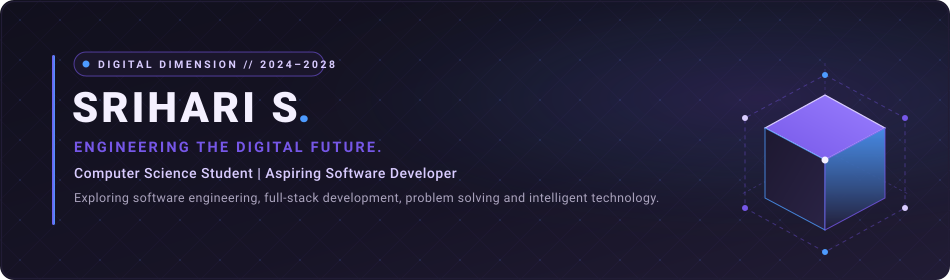
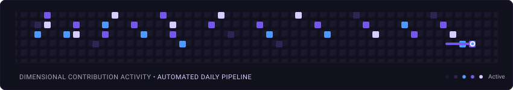

<div align="center">

<!-- Dimensional Futuristic Hero Header -->
<a href="https://github.com/Srihari-Asus">
  
</a>

<br/>

<!-- Subtle Typing Introduction -->
<a href="https://github.com/Srihari-Asus">
  
</a>

<br/>

<!-- Dimensional Connection Links -->
<p align="center">
  <a href="https://github.com/Srihari-Asus" target="_blank">
    
  </a>
  &nbsp;
  <a href="https://www.linkedin.com/in/sriharis2305" target="_blank">
    
  </a>
  &nbsp;
  <a href="https://leetcode.com/u/Srihari_Leetcode/" target="_blank">
    
  </a>
  &nbsp;
  <a href="mailto:srihari23052007@gmail.com">
    
  </a>
  &nbsp;
  <a href="https://www.instagram.com/sri.hari_23/" target="_blank">
    
  </a>
</p>

<!-- Section Divider -->


</div>

## ABOUT ME

```yaml
Profile:
  Identity: Srihari S.
  Status: Aspiring Software Development Engineer
  Institution: Sri Krishna College of Technology
  Degree: Bachelor of Engineering
  Department: Computer Science and Engineering
  Batch: 2024 — 2028
  Focus_areas:
    - Software Engineering & Architecture
    - Full-Stack Application Development
    - Java & Algorithmic Problem Solving
    - Practical System Engineering
    - AI-Assisted Technology
```

I am a Computer Science and Engineering undergraduate at **Sri Krishna College of Technology** (Batch 2024–2028), driven by a structured approach to software engineering and modern full-stack development. My technical core is grounded in **Java**, algorithmic problem-solving, and building practical, high-utility applications designed for production reliability.

In parallel with foundational engineering, I am actively exploring **AI-assisted technology** and intelligent software systems—focusing on turning complex requirements into clean, scalable, and maintainable digital solutions.

<div align="center">
  
</div>

## EXPERTISE

<div align="center">

| Domain | Technologies |
| :--- | :--- |
| **PROGRAMMING LANGUAGES** |  |
| **FRONTEND** |  |
| **BACKEND** |  |
| **DATABASES** |  |
| **TOOLS** |  |

</div>

<div align="center">
  
</div>
<br/>

<div align="center">

<picture>
  <source media="(prefers-color-scheme: dark)" srcset="https://raw.githubusercontent.com/Srihari-Asus/Srihari-Asus/output/github-contribution-grid-snake-dark.svg" />
  <source media="(prefers-color-scheme: light)" srcset="https://raw.githubusercontent.com/Srihari-Asus/Srihari-Asus/output/github-contribution-grid-snake.svg" />
  
</picture>

</div>

<div align="center">
  
</div>

<!-- Dimensional Footer -->
<div align="center">

<a href="https://github.com/Srihari-Asus">
  
</a>

<br/><br/>


</div>
