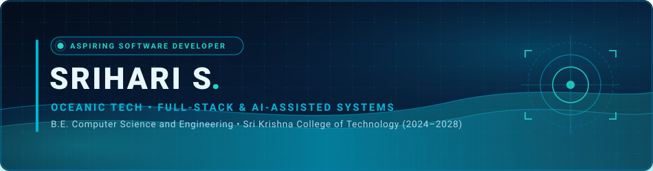

<div align="center">

<!-- Oceanic Futuristic Hero Banner -->
<a href="https://github.com/Srihari-Asus">
  
</a>

<br/>

<!-- Animated Typing Introduction -->
<a href="https://github.com/Srihari-Asus">
  
</a>

<br/>

<!-- Social & Communication Quick Bar -->
<p align="center">
  <a href="https://www.linkedin.com/in/sriharis2305" target="_blank">
    
  </a>
  <a href="https://leetcode.com/u/Srihari_Leetcode/" target="_blank">
    
  </a>
  <a href="https://github.com/Srihari-Asus" target="_blank">
    
  </a>
  <a href="mailto:srihari23052007@gmail.com">
    
  </a>
  <a href="https://instagram.com/sri.hari_23" target="_blank">
    
  </a>
</p>

<!-- Oceanic Section Divider -->


</div>

## 🌊 About Me

```yaml
profile:
  name: Srihari S
  status: Aspiring Software Development Engineer
  education:
    degree: Bachelor of Engineering
    department: Computer Science and Engineering
    institution: Sri Krishna College of Technology
    batch: 2024 — 2028
  focus_areas:
    - Full-Stack Web Architecture
    - Java & Algorithmic Problem-Solving
    - Building Practical Scalable Applications
    - AI-Assisted Technologies
```

I am a Computer Science and Engineering undergraduate at **Sri Krishna College of Technology** (2024–2028), driven by a strong interest in software development and full-stack engineering. My technical foundation centers on **Java**, algorithmic problem-solving, and constructing robust, practical digital applications that solve real-world challenges.

Alongside core engineering, I am actively exploring **AI-assisted technology** and intelligent application architectures, aiming to design software systems that are reliable, performant, and purposeful.

<div align="center">
  
</div>

## 🛠️ Technical Skills

<div align="center">

| Category | Technologies |
| :--- | :--- |
| **Programming** |  |
| **Frontend** |  |
| **Backend** |  |
| **Databases** |  |
| **Tools** |  |

</div>

<div align="center">
  
</div>

## 🚀 Featured Projects

<table width="100%">
  <tr>
    <td width="100%" valign="top">
      <h3 align="center">🌱 AgroPlay — AI-Assisted Smart Farming Ecosystem</h3>
      <p align="center">
        
        
        
        
      </p>
      <p>An intelligent, AI-assisted smart farming ecosystem architected to support precision agriculture and empower farmers with data-driven decision-making tools.</p>
      <ul>
        <li><b>Core Concept:</b> AI-assisted agricultural monitoring and decision-support systems.</li>
        <li><b>Architecture:</b> Mobile client interface engineered with React Native, powered by Firebase and structured PostgreSQL data layers.</li>
        <li><b>Applied AI:</b> Integrates Machine Learning models for intelligent agricultural predictions and advisory services.</li>
      </ul>
    </td>
  </tr>
</table>

<div align="center">
  
</div>

## 💼 Experience

<table width="100%">
  <tr>
    <td>
      <h4 style="margin-bottom: 4px;">Full Stack Developer Intern &nbsp;•&nbsp; <i>Knite Infotech</i></h4>
      <p><i>[Duration: Add Internship Timeline]</i></p>
      <ul>
        <li><b>Core Focus:</b> [Add key responsibilities and contributions here]</li>
        <li><b>Full-Stack Development:</b> Contributed to client and server-side feature development, application workflows, and integration.</li>
        <li><b>Technologies:</b> [Add specific tech stack details used during the internship]</li>
      </ul>
    </td>
  </tr>
</table>

<div align="center">
  
</div>

## 🏆 Achievements & Certifications

<table width="100%">
  <tr>
    <td width="33%" valign="top">
      <h4 align="center">🥇 DHRUVA '26</h4>
      <p align="center"><b>First Place</b><br/>Among 70+ competing teams at Karpagam College of Engineering.</p>
    </td>
    <td width="33%" valign="top">
      <h4 align="center">🇮🇳 Smart India Hackathon</h4>
      <p align="center"><b>Top 500</b><br/>Nationwide finalist recognition in India's premier hackathon initiative.</p>
    </td>
    <td width="34%" valign="top">
      <h4 align="center">📜 LambdaTest TestMu AI Marathon</h4>
      <p align="center"><b>Certificate of Completion</b><br/><i>(Subject to verification of certificate details)</i></p>
    </td>
  </tr>
</table>

<div align="center">
  
</div>

## 🧩 LeetCode & Problem Solving

<div align="center">

<a href="https://leetcode.com/u/Srihari_Leetcode/" target="_blank">
  
</a>

<br/>

<a href="https://leetcode.com/u/Srihari_Leetcode/" target="_blank">
  
</a>

<br/>
<sub><i>Click card or badge above to view live verification on LeetCode.</i></sub>

</div>

<div align="center">
  
</div>

## 📊 GitHub Analytics

<div align="center">

  <table border="0">
    <tr>
      <td align="center">
        <a href="https://github.com/Srihari-Asus">
          
        </a>
      </td>
      <td align="center">
        <a href="https://github.com/Srihari-Asus">
          
        </a>
      </td>
    </tr>
  </table>

  <br/>

  <a href="https://github.com/Srihari-Asus">
    
  </a>

</div>

<div align="center">
  
</div>

## 🐍 Contribution Graph

<div align="center">

<picture>
  <source media="(prefers-color-scheme: dark)" srcset="https://raw.githubusercontent.com/Srihari-Asus/Srihari-Asus/output/github-contribution-grid-snake-dark.svg" />
  <source media="(prefers-color-scheme: light)" srcset="https://raw.githubusercontent.com/Srihari-Asus/Srihari-Asus/output/github-contribution-grid-snake.svg" />
  
</picture>

</div>

<div align="center">
  
</div>

## 🌐 Connect With Me

<div align="center">

<p align="center">
  <a href="https://github.com/Srihari-Asus" target="_blank">
    
  </a>
  &nbsp;
  <a href="https://www.linkedin.com/in/sriharis2305" target="_blank">
    
  </a>
  &nbsp;
  <a href="https://leetcode.com/u/Srihari_Leetcode/" target="_blank">
    
  </a>
  &nbsp;
  <a href="mailto:srihari23052007@gmail.com">
    
  </a>
  &nbsp;
  <a href="https://instagram.com/sri.hari23" target="_blank">
    
  </a>
</p>

<!-- Quote Card -->


<br/>

<!-- Oceanic Footer Waves -->


<br/>

<sub>Architected with Oceanic Tech Precision • <b>Srihari S</b> • 2026</sub>

</div>
